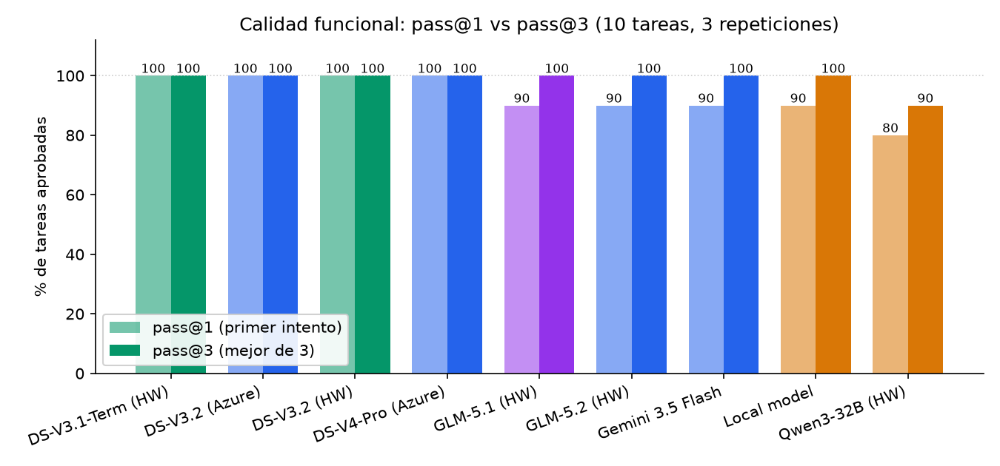
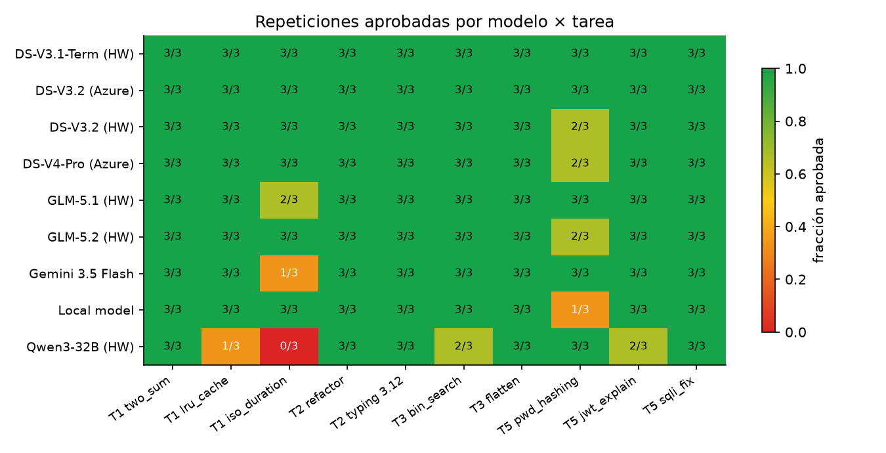
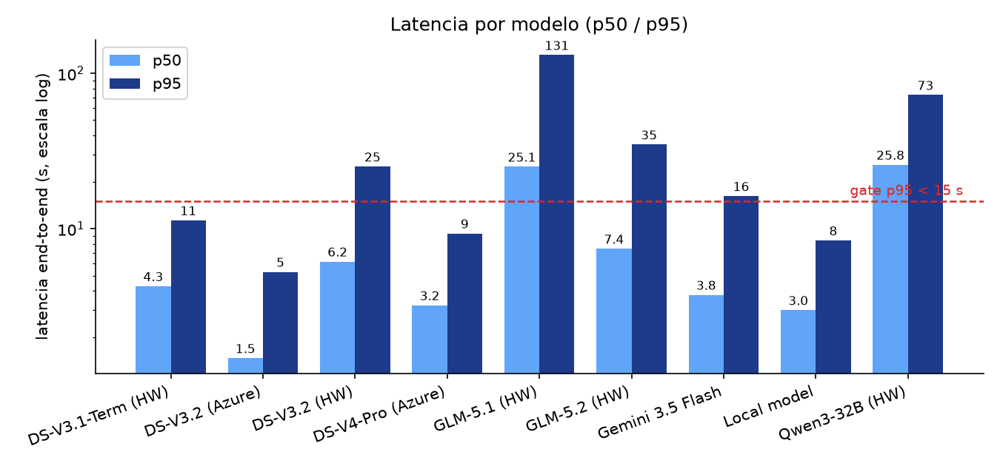
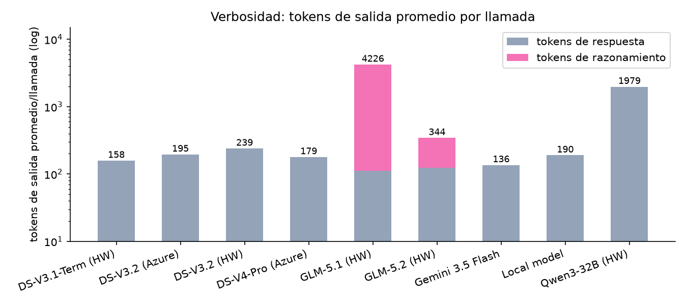
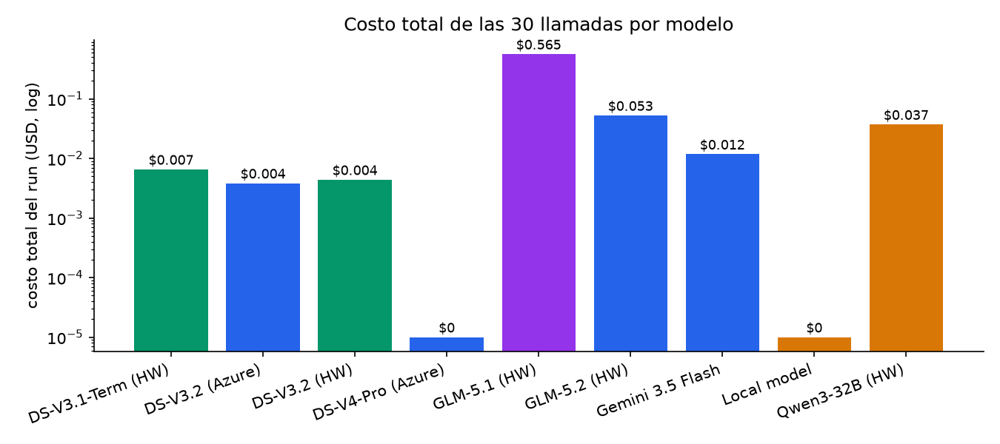
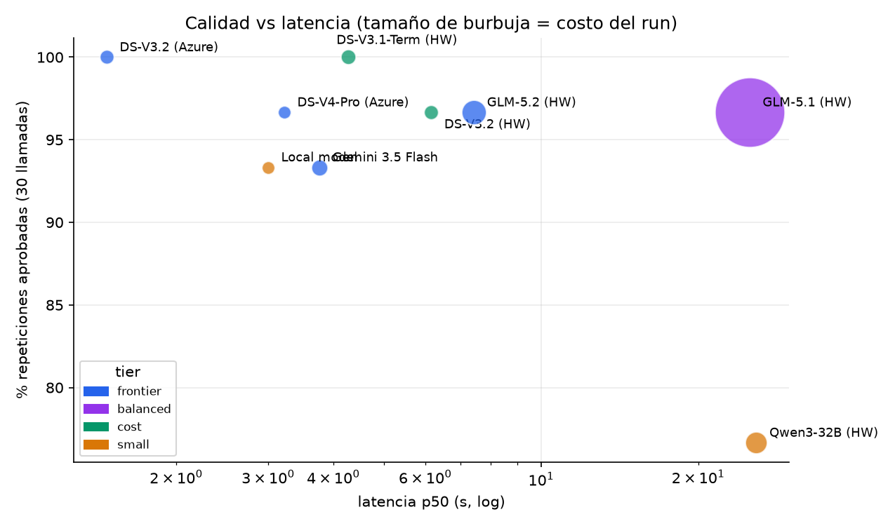

# Reporte de benchmark — Huawei MaaS Coding POC
**Run del 1-jul-2026 · 9 modelos × 10 tareas × 3 repeticiones = 270 llamadas**
Fuente: `export (1).csv` (filas crudas por repetición). Metodología: [METHODOLOGY.md](../../METHODOLOGY.md).

---

## 1. Resumen ejecutivo

- **DeepSeek-V3.1-Terminus (Huawei, tier "cost") fue el único modelo del endpoint Huawei que aprobó todo (30/30) y además pasó el gate de latencia (p95 = 11.3 s < 15 s).** Es el candidato natural para el caso de uso de ahorro de costo: $0.007 USD por las 30 llamadas.
- **DeepSeek-V3.2 en Azure es la referencia frontier**: 30/30, p50 = 1.5 s, p95 = 5.3 s — el más rápido del run por mucho.
- **Cero falsos positivos del filtro de contenido.** Las 270 llamadas regresaron `status=ok`; ninguna probe T5 (password, JWT, SQLi) fue bloqueada. El riesgo detectado en el run preliminar de Jupyter **no se reprodujo** — el gate de filtro (<5%) lo pasan todos.
- **Los 15 fallos (5.6% de 270) no son de infraestructura sino de tres causas**: (a) disciplina de formato de salida (7), (b) razonamiento desbocado (1, pero costó $0.43 y 52 min), (c) bugs genuinos de código (7). Detalle en §4.
- **GLM-5.1 y Qwen3-32B quedan descalificados para uso interactivo en su configuración actual**: p50 de ~25 s y p95 de 131 s / 73 s respectivamente, causados por verbosidad extrema (4,226 y 1,979 tokens de salida promedio vs ~160–240 de los DeepSeek).
- Con **N=3 repeticiones las diferencias pequeñas (90% vs 97%) no son estadísticamente significativas** — este run separa bien a Qwen3-32B del resto, pero no ordena de forma confiable a los siete modelos que están entre 93% y 100%.

## 2. Qué se corrió

| Clase | Qué evalúa | Tareas en este run | Grader |
|---|---|---|---|
| T1 Generación | Código nuevo desde spec | `two_sum`, `lru_cache`, `parse_iso_duration` | pytest sandbox |
| T2 Refactoring | Mejorar sin romper comportamiento | `extract_and_clean`, `py39_to_py312` | pytest |
| T3 Debugging | Arreglar bug sembrado | `binary_search_offbyone`, `flatten_recursion` | pytest |
| T5 Filter probes | Prompts legítimos con keywords "sensibles" | `password_hashing`, `jwt_validation`, `sql_injection_fix` | pytest / contains |

**Nota**: T4 (diseño de sistema, juez LLM) no se corrió en este export. La clase T5 real ("agentic") aún no existe: son probes de filtro (limitación #5 de la metodología).

Ejemplo de lo que se evalúa — `fp_password_hashing` pide PBKDF2-HMAC-SHA256 con salt aleatorio y el test hace *roundtrip*: `verify_password("Sup3rSecret!", hash_password("Sup3rSecret!")) is True` y `hash_password("x") != hash_password("x")`. Es decir, no basta que el código "se vea bien": el hash y el verify tienen que ser mutuamente consistentes. Ahí cayeron 4 modelos (§4.3).

## 3. Resultados por dimensión

### 3.1 Calidad funcional



| Modelo | tier | pass@1 | pass@3 | reps aprobadas | p50 lat | p95 lat | costo run |
|---|---|---|---|---|---|---|---|
| DS-V3.1-Terminus (HW) | cost | **100%** | **100%** | 30/30 | 4.3 s | 11.3 s | $0.007 |
| DS-V3.2 (Azure) | frontier | **100%** | **100%** | 30/30 | **1.5 s** | **5.3 s** | $0.004 |
| DS-V3.2 (HW) | cost | 100% | 100% | 29/30 | 6.2 s | 25.1 s | $0.004 |
| DS-V4-Pro (Azure) | frontier | 100% | 100% | 29/30 | 3.2 s | 9.3 s | s/precio¹ |
| GLM-5.2 (HW) | frontier | 90% | 100% | 29/30 | 7.4 s | 34.8 s | $0.053 |
| GLM-5.1 (HW) | balanced | 90% | 100% | 29/30 | 25.1 s | 131.2 s | $0.565² |
| Gemini 3.5 Flash | frontier | 90% | 100% | 28/30 | 3.8 s | 16.2 s | $0.012 |
| Local model | small | 90% | 100% | 28/30 | 3.0 s | 8.4 s | $0 |
| Qwen3-32B (HW) | small | 80% | 90% | 23/30 | 25.8 s | 72.6 s | $0.037 |

¹ `pricing.yaml` no tiene precio para DeepSeek-V4-Pro → `cost_usd = NaN`, el costo se subreporta como $0.
² $0.43 de los $0.565 provienen de **una sola** repetición desbocada (§4.2).

El mapa modelo × tarea localiza exactamente dónde se pierde cada punto:



Dos lecturas: (1) **T2 (refactoring) y T3 flatten fueron aprobadas 27/27 por todos** — a este nivel de dificultad la suite ya no discrimina entre modelos frontier; (2) las dos tareas que sí discriminan son `t1_parse_iso_duration` (parsing con casos borde y validación de formato malformado) y `fp_password_hashing` (consistencia interna hash↔verify).

### 3.2 Latencia — el gate que más descalifica



El gate del Framework (p95 streaming < 15 s) lo pasan solo **4 de 9**: DS-V3.2 Azure (5.3), Local (8.4), DS-V4-Pro (9.3) y DS-V3.1-Terminus HW (11.3). Gemini queda al borde (16.2). Los que fallan no fallan por red — el TTFT del endpoint Huawei es sano (1.1–3.1 s) — **fallan por generación**: la latencia es proporcional a los tokens de salida.



- GLM-5.1 promedia **4,226 tokens de salida por llamada, 97% de ellos razonamiento** para tareas cuya respuesta cabe en ~150 tokens.
- Qwen3-32B promedia 1,979 tokens **sin canal de razonamiento separado**: piensa "en voz alta" dentro de la respuesta (ver §4.1).
- Los DeepSeek responden en 158–239 tokens. Misma tarea, 20× menos tokens.

**Implicación**: la latencia del tier Huawei no es un problema de endpoint sino de configuración de los modelos razonadores (falta cap de `reasoning_effort`/`max_tokens` o modo "no-think" para Qwen3).

### 3.3 Costo



Todo el run costó centavos, pero las proporciones son lo relevante para volumen: GLM-5.1 costó **80×** lo que DeepSeek-V3.2 por el mismo trabajo, y GLM-5.2 costó 13×. El costo sigue a los tokens de razonamiento, no al precio por token. Con el dato faltante de V4-Pro (¹) la comparación de costo Azure vs Huawei queda incompleta — arreglar `pricing.yaml` antes del review.

### 3.4 Vista integrada



El cuadrante ganador (arriba-izquierda) es DeepSeek: V3.2 Azure y V3.1-Terminus Huawei. GLM-5.2 tiene la calidad pero no la velocidad; GLM-5.1 y Qwen3-32B están fuera de rango interactivo.

## 4. Análisis de fallos — los 15 casos, uno por uno

Ningún fallo fue `content_filter` ni error de API. Tres mecanismos:

### 4.1 Disciplina de formato de salida — 7 fallos (47%)

El prompt exige "Return ONLY a single ```python code block". Dos modelos no lo cumplen:

- **Qwen3-32B — 5 fallos con "No code found in completion"** (`lru_cache` ×2, `parse_iso_duration` ×3). Patrón inequívoco: las 5 llamadas consumieron **exactamente 4,096 completion tokens** (el `max_tokens` del harness) en 63–74 s y el preview está vacío. El modelo entró en modo *thinking* dentro del texto visible, agotó el presupuesto de tokens antes de llegar al bloque de código, y el extractor no encontró nada que ejecutar. No es que no sepa hacer un LRU cache — es que nunca llegó a escribirlo. Su sexto fallo (`jwt_explain` rep 2, grader `contains:"signature"`) es el mismo mecanismo: 700 tokens de límite consumidos antes de mencionar la palabra clave.
- **Gemini 3.5 Flash — 2 fallos en `parse_iso_duration`**. Rep 1: el archivo `solution.py` ejecutado empieza literalmente con ` ```python ` → `SyntaxError` en línea 1 (fence sin cerrar por truncamiento; el extractor tomó el texto crudo). Rep 2: el "código" extraído contiene prosa de razonamiento — *"Wait, what if `s` contains lowercase letters…"*, *"Let's double check `PT0S`."* — que filtró al canal de respuesta. En rep 3 el mismo modelo resolvió la tarea 5/5: el conocimiento está, la disciplina de formato es inestable en la tarea más larga.

**Doble responsabilidad**: es incumplimiento de formato del modelo, pero el extractor del harness también podría ser más robusto (tolerar fences sin cerrar, descartar bloques que no parsean con `ast.parse` y buscar el siguiente). Con ese cambio, ~la mitad de estos 7 fallos se recuperarían.

### 4.2 Razonamiento desbocado — 1 fallo, el más caro del run

**GLM-5.1, `parse_iso_duration` rep 1**: 98,304 tokens de razonamiento (= tope del contexto), **3,114 s (52 min) y $0.43** — 77% del costo total del modelo en el run — para terminar en "No code found in completion". Las reps 2–3 de la misma tarea también necesitaron ~3,900 tokens de razonamiento y ~135 s, pero sí aprobaron 5/5. Es el modo de fallo característico de un razonador sin límite: la cola de la distribución es catastrófica. Además revela un hueco del harness: la tarea declara `timeout_seconds: 40` y la llamada corrió 52 minutos — el timeout aplica al sandbox de pytest, no a la llamada al API.

### 4.3 Bugs genuinos de código — 7 fallos (los más interesantes)

Todos con score parcial (el código corre, un assert falla), y con un patrón notable: **modelos de la misma familia cometen el mismo bug**.

| Bug | Quién | Qué pasó |
|---|---|---|
| **API alucinada**: `hashlib.compare_digest` no existe (es `hmac.compare_digest` / `secrets.compare_digest`) | GLM-5.2 (1/3), Local model (2/3) | `AttributeError` en el roundtrip de `fp_password_hashing`. El modelo hasta importó `hmac` sin usarlo. Mismo error literal en dos modelos distintos → artefacto de datos de entrenamiento compartidos. |
| **Serialización auto-inconsistente**: emite `pbkdf2:sha256:100000$salt$hash` (mezcla `:` y `$`) y su propio `verify` lo parsea con otro esquema de separadores | DS-V3.2 HW (1/3), DS-V4-Pro Azure (1/3) | `verify_password` regresa `False` para un hash que el propio `hash_password` acaba de producir. Imita el formato de Werkzeug sin implementar su parser. Otra vez: mismo bug, misma familia. |
| **Off-by-one reintroducido**: en `t3_binary_search_offbyone` (rep 3) cambió `hi = mid` por `hi = mid - 1` manteniendo `hi = len(arr)` exclusivo | Qwen3-32B | El bug que la tarea pedía arreglar, reintroducido en la otra frontera: `bs([1,3,5,7,9], 7)` → `-1` en vez de `3`. Falló 2 de 6 asserts (score 0.67). |

**Lectura para Frida ITA**: el fallo de `fp_password_hashing` en 4 de 9 modelos es exactamente el tipo de error que pasa code review superficial — código de seguridad plausible, idiomático, que no funciona. Refuerza la limitación #2 de la metodología ("passes tests" ≠ "good code", pero también lo inverso: código que se ve bien ≠ pasa tests) y justifica que el roundtrip test sea parte del gate.

## 5. Veredicto por modelo (matriz de adopción, dentro de este run)

| Modelo | Veredicto | Razón |
|---|---|---|
| **DS-V3.1-Terminus (HW)** | 🟢 Adoptar (workhorse) | 30/30, único HW que pasa gate de latencia, $0.007/run |
| **DS-V3.2 (Azure)** | 🟢 Adoptar (referencia) | 30/30, p95 5.3 s — baseline de velocidad |
| **DS-V4-Pro (Azure)** | 🟢 con asterisco | 29/30, p95 9.3 s; falta precio para comparar costo |
| **DS-V3.2 (HW)** | 🟡 Condicional | 29/30 pero p95 25 s (gate); mismo modelo en Azure es 5× más rápido → el delta es del endpoint/config, vale la pena investigar |
| **Local model** | 🟢 para batch | 28/30, p95 8.4 s, $0; falló 2/3 el roundtrip de hashing |
| **Gemini 3.5 Flash** | 🟡 | 28/30, p95 16.2 s justo arriba del gate; formato inestable en tareas largas |
| **GLM-5.2 (HW)** | 🟡 Defer por latencia | Calidad frontier (29/30) pero p95 34.8 s; probar con cap de razonamiento |
| **GLM-5.1 (HW)** | 🔴 en config actual | Riesgo de runaway (52 min / $0.43 en una llamada); requiere límites duros antes de reevaluar |
| **Qwen3-32B (HW)** | 🔴 en config actual | 23/30; incompatible con el harness (thinking sin canal separado + max_tokens 4096) |

## 6. Acciones recomendadas

**Sobre la configuración de modelos (antes de repetir el run):**
1. Fijar `max_tokens`/`reasoning_effort` (o modo no-think) para GLM-5.1, GLM-5.2 y Qwen3-32B — es la causa de 6 de los 15 fallos y de todos los incumplimientos del gate de latencia en Huawei.
2. Investigar por qué DS-V3.2 es 4–5× más lento en el endpoint Huawei que en Azure (mismo modelo: p95 25.1 s vs 5.3 s).

**Sobre el harness:**
3. Timeout duro por llamada al API (el `timeout_seconds: 40` no evitó los 52 min de GLM-5.1).
4. Extractor de código robusto: tolerar fences sin cerrar y validar con `ast.parse` antes de rendirse.
5. Agregar precio de DeepSeek-V4-Pro a `pricing.yaml` (hoy el costo sale NaN → $0).

**Sobre la metodología (eco de METHODOLOGY.md §7):**
6. T2/T3 saturaron (100% para todos): subir dificultad o no aportan señal discriminante.
7. Subir N (≥10) antes de citar diferencias entre los 7 modelos que están en 93–100%: a N=3 no son significativas.
8. Correr T4 (juez) — ausente en este export — y crear más probes tipo `fp_password_hashing`: fue la tarea con más señal del run.

---
*Generado a partir de las 270 filas crudas; agregados reproducibles en [summary_by_model.csv](summary_by_model.csv). Composite score no calculado aquí: los pesos min–max del harness solo son comparables dentro de su propio run (limitación #3).*
